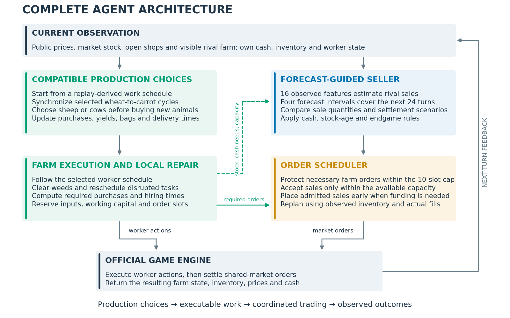

# Kaggriculture: reliable production, competitive markets

[中文使用说明](README.zh-CN.md) · [Full solution report](docs/report/REPORT.md) · [Architecture & code map](docs/ARCHITECTURE.md) · [Reproduce](docs/REPRODUCING.md)

[Download the packaged agent](https://github.com/shawny1b0609/kaggriculture-solution/releases/tag/v1.0.0) · [Release checks](provenance/RELEASE_CHECKS.md)

A reproducible release of Kaggle submission **56707930**: a replay-derived
farm executor with compatible crop and livestock choices, plus a
public-information opponent-flow predictor and a conservative selling policy.

The central shift was from **maximizing farm output in isolation** to
**improving terminal cash difference in a shared market**. Reliable production
provides the foundation; sale timing and carefully constrained production
choices respond to the market and the opponent.



## What is included

- The final agent, its trained forecast model, production schedule, crop-cycle
  bank and livestock compatibility certificates.
- The English competition report, full architecture diagram, supporting
  figures and compact historical result tables.
- Official-engine self-play, recorded-production opponent evaluation,
  action-parity checks and submission packaging.
- Replay-to-training-data extraction and training/export of the market
  predictor. No training is required to run the released agent.
- A research history explaining fixed schedules, decision forests, node
  selection experiments and the transition to market-aware competition.

Raw replay collections, credentials, caches and large intermediate experiments
are not included. This is the final solution and its research record, not an
unfiltered backup of the development machine.

## Results

| Evaluation | Result | Scope |
|---|---:|---|
| Online score snapshot | **2226.6** | Submission 56707930, queried October 15, 2026 |
| Completed public games | **535 wins / 925 games (57.84%)** | September 30–October 14; one errored game excluded |
| Online mean terminal cash | **104,604** | Same 925 games |
| Online mean cash difference | **+890** | Same 925 games |
| Local confirmation improvement | **+1,770 cash difference** | 18 recorded-opponent scenarios, two seats per version |

The local confirmation compares crop+livestock adaptation against its
crop-only predecessor, holding the market model fixed. Its exploratory 95%
interval is −144 to +3,828. Local contract games and online games use different
opponents and are reported separately. These are dated measurements, not a
current leaderboard rank. See [evaluation](docs/EVALUATION.md) and
[historical evidence](results/historical).

## Quick start

Tested with Python 3.11 and `kaggle-environments==1.32.7`. A CPU is sufficient;
the deployed predictor uses portable Python trees. PyTorch remains an import
dependency of the inherited execution infrastructure, but there is no PPO
policy in the final agent.

```bash
git clone https://github.com/shawny1b0609/kaggriculture-solution.git
cd kaggriculture-solution
conda create -n kaggriculture python=3.11 -y
conda activate kaggriculture
python -m pip install -r requirements.txt
python -m unittest discover -s tests -v
python scripts/evaluate.py --seeds 0 --out results/local/selfplay.json
python scripts/package_agent.py
```

The last command creates `dist/submission.tar.gz`, with `main.py` at the
archive root. It does not submit anything to Kaggle. For more seeds, pass
`--seeds 0 1 2`; results include cash, production matching and the choices made.

## How the agent works

1. **Keep a feasible production skeleton.** Reuse a compiled high-performing
   schedule, with delayed-action alignment, just-in-time procurement,
   hiring, warehouse accounting and local weed/cash repairs.
2. **Change only compatible production blocks.** Select synchronized
   wheat/carrot cycles and certified cow/sheep placements. Recompile resource
   needs, deliveries and reference states together when a choice changes.
3. **Estimate rival supply from public information.** A 16-feature predictor
   estimates sales in four future intervals. It never observes private rival
   inventory, unrevealed shops or future market prices.
4. **Trade without blocking the farm.** Reserve order capacity for necessary
   farm operations. Use the remaining slots for liquidity protection and a
   small scenario-based search over sale quantities and timing.

This is limited, explicit flexibility—not a general-purpose farm planner or
a learned full-game policy. The [report](docs/report/REPORT.md) explains both
the useful adaptations and the remaining production-planning opportunities.

## Repository map

```text
agent/                  Frozen final inference code and assets
  main.py               Kaggle entry point
  implementation/       Execution, repairs, ordering and schedule infrastructure
  market_game_20260930/  Public-flow forecasting, selling and compatible choices
scripts/                Portable run, train, evaluate, audit and package commands
evaluation/             Recorded-production contract compiler and simulator
tests/                  Runtime, market and provenance checks
docs/                   Method, reproduction, data, history and English report
results/historical/     Dated results and compact source tables
provenance/             Source hashes and original training split
research/               Selected original research implementations
```

The dated Python module names are retained to preserve the released import
graph. Their human-readable meanings and entry points are in the
[code map](docs/ARCHITECTURE.md).

## Training and data

Install `requirements-training.txt`, obtain complete authorized public
replays, and prepare a replay manifest:

```bash
python scripts/prepare_flow_data.py --replays data/replays.json --out-dir data/flow
python scripts/train_flow.py --manifest data/flow/data_manifest.json --out-dir results/local/retrained
```

Training uses complete-episode splits, executed sales rather than requested
orders, and four Poisson gradient-boosted regressors. A portable export is
checked against scikit-learn predictions. See [data preparation](docs/DATA.md)
for the schema, source attribution and original 200/99-episode split.

## License and attribution

Original code and documentation: [MIT](LICENSE). The offline scenario-engine
copy remains Apache-2.0. Replay-derived assets and dependencies retain their
source terms; see [third-party notices](THIRD_PARTY_NOTICES.md).

The production route is derived from public replay **113905606, seat 0**,
not claimed as an original from-scratch route. The report credits the
[Daily Top Episodes collection](https://www.kaggle.com/competitions/kaggriculture/discussion/731215)
and related participants' published solutions. Issues and reproducible bug
reports are welcome; see [contributing](CONTRIBUTING.md).
