# From Production Optimization to Competitive Farming

## A Rule-Guided Kaggriculture Agent with Opponent-Aware Trading and Compatible Production Choices

*Solution report · September 30 submission, reviewed October 15, 2026*

### At a glance

My final agent combines a reliable production schedule extracted from game replays with two kinds of adaptation: an opponent-aware seller that decides when and how much to sell, and crop/livestock choices that preserve an already-tested execution schedule. Rules coordinate farm execution, while a small learned model estimates the opponent's future sales.

The central lesson was a change in the question I asked. I initially asked, **“How can I produce more, or finish with more money?”** Eventually, the more useful question became, **“How does this decision change the money difference between my opponent and me?”** In a shared market, those questions can have different answers.

The final submission, **56707930**, combines synchronized crop substitutions, adaptive livestock selection, and forecast-guided selling. Adding livestock selection improved mean cash difference by 1,770 across 18 recorded-opponent scenarios in the local confirmation test. The October 15 online snapshot reported a score of **2226.6** and **535 wins in 925 completed public games (57.84%)**. Sections 8 and 10 describe the local and online results separately.

## 1. Why farming was also a competitive market problem

Kaggriculture couples a farm-management problem to a shared-market problem. Workers must carry out feasible sequences of movement, planting, watering, feeding, harvesting, and delivery. Meanwhile, both players sell into the same market, where supply changes prices and town shops consume products. The game therefore rewards more than a large production total. Timing, product mix, working capital, and the opponent's supply all matter. The official implementation is the reference for action ordering, production, and market settlement. [1](https://github.com/Kaggle/kaggle-environments/blob/master/kaggle_environments/envs/kaggriculture/kaggriculture.py)

For analysis, I used terminal money difference:

```text
margin = our terminal cash - opponent terminal cash

change in margin = change in our cash - change in opponent cash
```

A move can increase our cash but increase the opponent's cash even more. Equally, two agents can produce the same goods and finish with different money because their selling decisions interact.

There are also two distinct notions of success:

- **Execution success:** the intended production and delivery occur without unrecovered disruption.
- **Competitive success:** that production, sold against this opponent in this market, wins the game.

Much of the project consisted of learning not to confuse the first with the second.

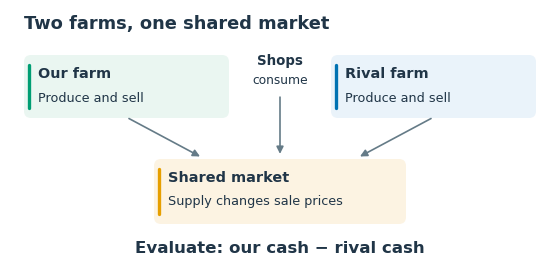

*Figure 1. Each farm has its own production plan, but both players' sales affect prices in the shared market.*

## 2. The research path: what changed, and why

The project used public high-scoring replays as demonstrations and sources of production plans. Kaggle's Daily Top Episodes discussion provided access to the replay collection used in the early imitation-learning and route-search experiments. Section 7 gives the training set used for the final market predictor. [2](https://www.kaggle.com/competitions/kaggriculture/discussion/731215)

| Stage | Main idea | What it taught me |
|---|---|---|
| High-throughput fixed schedules | Reuse strong planting, livestock, and worker schedules. | A reliable schedule is valuable, but it may pursue nearly the same business regardless of market conditions. |
| Daily-target imitation and general executors | Predict a desirable farm state, then ask an executor to reach it. | Accurate state prediction is not enough. Targets may be jointly infeasible, or the executor may miss the resource and timing dependencies needed to realize them. |
| Replay-derived decision forests | Join compatible daily farm states and choose among prerecorded production continuations. | A shared farm snapshot is not the entire execution state. Inventory, bags, worker identities, hire timing, and unresolved tasks must also remain compatible. |
| Node-selection RL and large route screening | Learn which branch to take; screen many routes for stability and self-play cash. | A large action space is not automatically a useful one. The selector cannot invent a winning production option, and a high self-play cash total does not establish strength against strong opponents. |
| Market-first competition, then constrained production choices | Freeze a strong executor, improve trading against opponents, and add production alternatives checked for execution compatibility. | This made changes easier to attribute and allowed useful adaptation without redesigning the whole farm. |

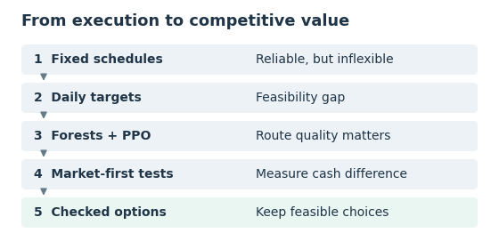

*Figure 2. Each research stage changed what I optimized: execution accuracy, route flexibility, competitive trading, and finally a small set of reliable production choices.*

### 2.1 Why good imitation metrics did not settle the execution problem

An early daily-target experiment used 25,923 distinct games and about 1.56 million player-day examples, each describing one player's farm for one game day. Its offline tile-state accuracy could look strong while actual farming remained weak. Most tiles often remain unchanged, so aggregate accuracy can hide a few critical errors: one missing seed, one late watering action, or an impossible combination of otherwise plausible targets.

There was also a planning issue. Independent tile predictions could mix fragments of different strategies without preserving a coherent resource budget. Some early scheduling logic was too all-or-nothing: when a complete daily plan was infeasible, it could fail to execute useful partial work. More training did not, by itself, repair that interface.

The lesson was not that imitation learning cannot work. It was that **the learned representation and the executor must agree about what can actually be executed**.

### 2.2 Why larger decision forests were not the final answer

The forest approach tried to make production flexible without learning every worker action. Each daily segment inherited a detailed action schedule; compatible states allowed a switch to another episode's continuation. Procurement and hiring were reconstructed around the selected schedule.

This exposed genuinely useful engineering problems: replay action alignment, random weeds, just-in-time purchases, worker spawn positions, order limits, and delayed recovery after a cash shortage. Solving those problems improved the eventual executor.

However, the forest also exposed a strategic limitation. More branches could mean many nearly identical production profiles, not more meaningful choices. Branches could cluster early, before informative shops opened, or an apparently high-yield route could require an unaffordable opening. A rule or RL selector could then collapse to one route because the remaining choices were weak or insufficiently differentiated.

A particularly instructive intermediate tree had three stable routes. Across nine difficult recorded-opponent scenarios, all 27 route/scenario runs completed production, but none won. The rule selector chose the same route in all nine scenarios. Execution had become reliable, but the available production choices were still too weak.

These experiences led to a narrower design: preserve a strong production backbone, diagnose the market independently, and add small, economically meaningful freedoms whose execution consequences could be checked.

## 3. The turning point: measure interaction, not just output

### 3.1 Freeze the farm to isolate the market

The first market-competition experiment held production code fixed and compared three sellers on 48 scenarios, each defined by a random seed and an opponent. Each scenario was played twice, swapping player positions. Six opponent types included three with the same production and three older agents with different production. Each seller played 96 games; the comparison contained 288 games in total.

| Seller | Mean own cash | Mean margin | Win rate, ties worth half |
|---|---:|---:|---:|
| Baseline rule-based seller | 106,710 | +3,148 | 62.5% |
| Opponent-aware revenue search | 107,171 | +6,388 | 89.6% |
| Revenue search with an opponent-income penalty | 105,249 | +5,772 | 83.3% |

The opponent-aware revenue search improved margin by approximately 3,241: our cash rose by about 462 while the opponent's fell by about 2,779. Production did not increase. In the same-production subset, win rate moved from 45.8% to 100%; against the three different-production agents, all three sellers had the same 79.2% win rate, despite differences in average margin.

The negative control mattered. Adding a stronger explicit penalty on the opponent's revenue did **not** produce the best seller. A short-horizon model can misprice the cost of hurting both players. The best local result came from anticipating the opponent while scoring our own revenue conservatively.

Thus, the shift toward competition was a shift in **observations, experiments, and acceptance criteria**, not simply the addition of a negative opponent-reward term.

### 3.2 The same production can win or lose through trading

In one difficult replay-based scenario, the environment preserved a recorded opponent's production while both agents traded at live market prices. Changing only our seller produced the following outcome. The opponent sold products immediately, and production quantities on both sides were unchanged.

| Our seller | Our cash | Opponent net cash | Margin |
|---|---:|---:|---:|
| Opponent-aware revenue search | 133,711 | 136,662 | −2,951 |
| Finer search with rule-based supply estimates | 130,918 | 136,610 | −5,692 |
| Forecast-guided seller | 135,893 | 134,518 | +1,375 |

The forecast-guided seller improved our cash by 2,182 and reduced opponent cash by 2,144: a 4,326 improvement in margin and a loss-to-win reversal.

On a separate confirmation test, the official engine ran both complete agents across 48 new seed/opponent scenarios, with 96 games per version. The forecast-guided seller improved mean margin over the opponent-aware revenue search by approximately 724; win rate rose from 91.67% to 93.75%. The paired-scenario interval for the margin gain was approximately +406 to +1,048. This test used six fixed local opponent types and fresh seeds.

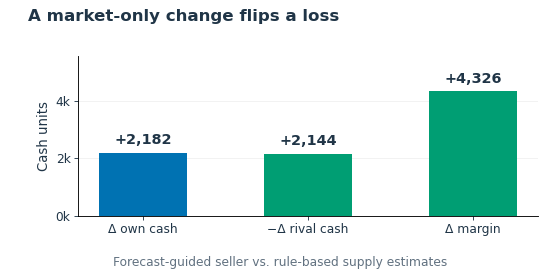

*Figure 3. In this example, replacing rule-based supply estimates with a learned forecast raised our cash by 2,182 and reduced rival cash by 2,144, producing a 4,326 margin gain.*

### 3.3 Why farming still had room to improve

Market improvements did not erase every production disadvantage. Against nine strong recorded production schedules, each paired with two opponent selling policies and both player positions, the forecast-guided seller won only 2 of 36 games, with mean margin −15,593. The preceding seller won none.

This motivated the next question: **can the farm change its product mix without losing the execution reliability that took so long to build?**

## 4. Final architecture: reliable execution with bounded adaptation

The final agent retained one tested production schedule extracted from a strong replay. It added a small set of crop and livestock alternatives whose complete work sequences had been checked for compatibility. The diagram below follows the full loop from observation to production decisions, worker execution, trading, and feedback.

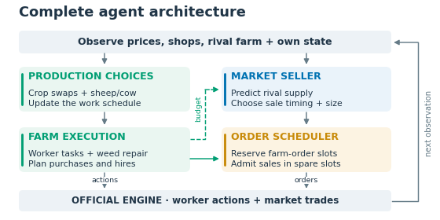

*Figure 4. The complete control loop. Production decisions update the work plan; the executor prepares worker actions and required purchases. The seller uses market forecasts and the farm's resource budget to propose sales. The scheduler combines these orders, and the next game observation closes the loop.*

| Component | What remains fixed | What adapts |
|---|---|---|
| Farm executor | Tested work structure and production dependencies | Local weed/cash recovery and feasible purchase/hire timing |
| Synchronized crop substitutions | Compatible worker schedules checked in advance | Selected wheat cycles may become carrot cycles |
| Adaptive livestock selection | Compatible placement, care, and transport structure | Selected planned new animals may change between sheep and cows |
| Forecast-guided seller | Production reserves, liquidity/capacity safeguards | Sale quantities and timing, using estimated opponent supply |

The architecture treats a production change as a **small plan recompilation**, not a text substitution. Changing what a worker plants or places also changes what must be bought, what will be harvested, what that worker carries, and what later reaches the shed.

## 5. Farm execution: preserving the useful part of the replay

### 5.1 Align the data before copying it

The action stored in replay frame `t + 1` produces the transition from observation `t` to observation `t + 1`. I used that alignment when extracting worker schedules and transaction labels.

The executor also distinguishes field-action time from market-settlement time. If a worker needs a seed or carried input for an action now, buying it later in that turn cannot be treated as if it were already available during the earlier action phase.

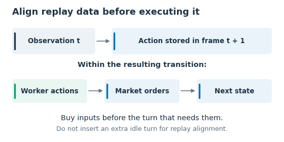

*Figure 5. Align the stored action with the transition it actually causes. Procurement cannot retroactively supply an earlier worker action.*

### 5.2 Reconstruct procurement and hiring around the action plan

The source provides a useful work schedule, but its historical market orders are not blindly reused. The executor determines upcoming input requirements and compares them with actual inventory. It preserves production reserves, schedules hiring around the source work sequence, and attempts to avoid spending scarce opening cash on unnecessary early purchases.

The ten-order limit is a hard scheduling constraint. Necessary farm orders reserve their capacity first. Sales may occupy the remaining slots and can appear before purchases to fund them, but they must not displace reserved necessary orders. Optional pre-purchases can reduce the residual sale capacity further. If necessary orders already fill all slots, liquidity must be raised earlier; the seller cannot invent an eleventh order.

The market receives not only available goods but also upcoming cash and capacity obligations. For example, selling before a nightly deposit can prevent shed overflow. Goods reserved as feed or fertilizer are not treated as freely disposable output.

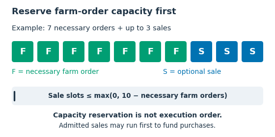

*Figure 6. With seven required farm orders, three of the ten slots remain available for sales. Accepted sales can execute first to fund purchases.*

### 5.3 Recover locally rather than discard the whole schedule

Random weeds can invalidate an otherwise correct prerecorded action. The recovery logic looks for a feasible extra clearing action in existing workers' schedules, including the worker that will use the affected tile; when necessary, it can use an extra worker. Position and worker-index bookkeeping matter because a helper must not silently change the meaning of the original commands.

Local resource shortages create deferred tasks. Recovery reschedules the affected work while preserving the rest of the plan, subject to the labor and resources still available.

New production substitutions are disabled when relevant recovery is unresolved or cash is below the selector's guard. In other words, flexibility is optional; restoring a disrupted farm takes priority.

## 6. Production flexibility without rebuilding the executor

### 6.1 Crops: compatible wheat-to-carrot cycles

The crop layer exposes 40 checked planting-to-harvest cycles over 15 planting days, beginning at day 10 under zero-based numbering. Each selected cycle must support carrot growth and harvesting within the original worker schedule.

The crop selector can replace up to two eligible cycles whose products reach the shed on the **same turn**. Synchronizing arrivals makes their combined supply easier to value. Before accepting a second replacement, it adjusts the market estimate for the first one's missing wheat and additional carrots.

The crop valuation blends current-price revenue and a projected supply/demand estimate, subtracts seed cost, and includes the opportunity cost of the original wheat. The guard requires cash of at least 2,000, no relevant pending recovery, and an estimated gain of at least 20. Wheat removed from production is not assumed to remain available as free animal feed.

Tomato and strawberry schedules remain fixed in this version.

### 6.2 Livestock: choose the animal before buying it

Cow and sheep plans share useful operations, but their maturation, production intervals, and accumulated care bonuses differ. Therefore, the final livestock layer first replays each candidate animal lifecycle with the official animal rules.

Of the 14 animal lifecycles in the source schedule, seven supported replacement. The opening schedule and more complex transport sequences stayed fixed. For every permitted replacement, the plan generator updates:

- animal pickup and placement instructions;
- required purchases and shed resource changes;
- expected harvest quantities and carried goods;
- delivery quantities and daily reference tile states.

Each game gets its own copy of the production schedule. Substitutions are decided before buying a new animal; if pickup occurs early the next day, the decision is brought forward so procurement buys the correct type.

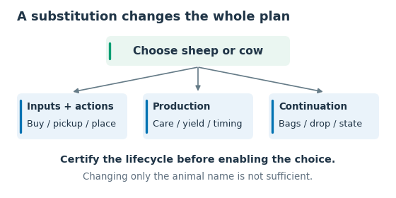

*Figure 7. An executable substitution must update the complete dependency chain, not just the animal name.*

### 6.3 Value the whole portfolio, not each animal in isolation

At an eligible decision point, the selector compares the current plan with each candidate alternative. Its estimate uses current prices and market inventory, already-open shops, visible rival livestock and their maturity, recent inferred rival supply, and our own remaining planned deliveries. Unknown future shops and the opponent's hidden warehouse are unavailable.

The score blends two estimates equally: a current-price opportunity estimate and a forward supply/demand projection. The forward projection includes the price impact of **all already-committed milk and wool**, so several candidate cows cannot each pretend to sell into an unaffected market. The animal purchase-cost difference is subtracted.

The selector is greedy, recomputing values after each accepted change. It requires estimated gain of at least 150, cash of at least 2,000, no unresolved recovery, and at most two animal changes per decision day.

```python
# Livestock-selection pseudocode.
if eligible_slots_today and cash >= 2000 and not unresolved_recovery:
    changed = 0
    while eligible_slots_today:
        baseline = portfolio_value(committed_plan, public_observation)
        slot, gain = best_remaining_alternative(
            committed_plan, public_observation, baseline,
            include_purchase_cost=True,
        )
        if gain >= 150 and changed < 2:
            recompile_plan_copy(slot)
            changed += 1
        eligible_slots_today.remove(slot)
```

Eligible decision days were 3, 4, 9, 11, and 12, but accepted substitutions in the formal tests concentrated on days 11–12 because of the opening cash requirements. Across those games, the selector replaced zero to three planned sheep with cows.

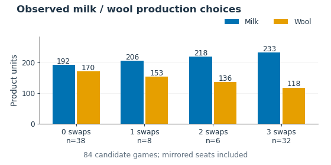

*Figure 8. Milk and wool output for zero to three sheep-to-cow substitutions. The counts cover all 84 candidate games, including both player positions.*

## 7. The market model: learn opponent supply, then search a small action space

### 7.1 What is learned

The market predictor estimates opponent sale quantities over four future intervals: `[0, 1)`, `[1, 4)`, `[4, 12)`, and `[12, 24)` turns. A small gradient-boosted tree model with a Poisson loss predicts the quantity in each interval. The models share parameters across products and use economic features rather than product or replay identifiers.

The 16 inputs are compact and economically interpretable:

| Group | Inputs |
|---|---|
| Time, 3 | Season progress, hour, time to next known shop-consumption tick |
| Market and demand, 4 | Normalized market inventory, relative price, price impact of five extra units, known daily shop demand |
| Visible rival capacity, 4 | Rival cash, relevant productive tiles, goods visibly held on those tiles, estimated three-day production |
| Supply history and uncertainty, 5 | Inferred unsold backlog, smoothed supply, recent 24-turn supply, time since last positive supply, flow-observability flag |

The public-flow tracker subtracts our own realized market contribution and accounts for known shop consumption. Ambiguous flows are marked uncertain rather than represented as exact hidden inventory.

The training labels are **executed sales**, not merely requested orders. This distinction prevents an unaffordable, unavailable, or otherwise unexecuted order from becoming a fictitious transaction label.

Training used 200 games from August 15–September 8, with 99 later games from September 9–16 held out for validation. These produced 1,252,800 training rows and 620,136 validation rows; observations from the same game are correlated.

Each interval model used 80 boosting iterations, at most 15 leaves, and maximum depth four. The exported trees run in pure Python during competition play.

### 7.2 What is searched

For an eligible sale product, the seller compares no sale, approximately one-quarter, one-half, three-quarters, and all available stock. It also includes the quantity recommended by the baseline rule-based seller, which handles cash needs, inventory age, and storage capacity. Candidate waiting horizons are known shop-consumption opportunities within 24 turns.

For each candidate, it considers three opponent-volume scales—0.5, 1.0, and 1.5 times the prediction—and three settlement positions: our sale before, alongside, or after the opponent's. Both sets use weights 0.25, 0.50, and 0.25. Revenues are calculated with the official unit-level price mechanics under each hypothesized order sequence.

The scoring rule is:

```text
score(quantity, horizon)
  = expected own revenue now and at the candidate horizon
    - 0.20 × downside deviation across scenarios
    - 0.002 × horizon × retained stock × base product price
```

The final term discourages indefinite holding. Each candidate values the immediate sale and a later liquidation of retained stock using the estimated supply and shop demand.

```python
# Simplified description of the deployed timing search.
for quantity in candidate_sale_quantities(stock, baseline_quantity):
    for horizon in known_consumption_ticks_within_24_turns():
        outcomes = []
        for volume_scale, volume_weight in volume_scenarios:
            for order_position, position_weight in ordering_scenarios:
                revenue = simulate_own_receipts(
                    quantity, horizon, predicted_rival_flow * volume_scale,
                    order_position, known_shop_demand, official_price_rules,
                )
                outcomes.append((revenue, volume_weight * position_weight))
        score = expected_value(outcomes) - downside_penalty(outcomes)
        score -= holding_penalty(quantity, horizon)
        keep_best_candidate(score, quantity, horizon)

quantity = max(best_quantity, overdue_sellable_quantity)
# Production reserves and admissible order slots still constrain issuance.
```

The final seller's explicit rival-income penalty is zero. It is opponent-aware because it models the opponent's supply and settlement interaction, not because it directly subtracts their profit in every local score.

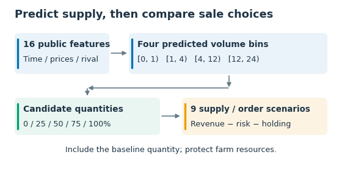

*Figure 9. The supply forecast feeds a search over sale quantities and timing. Nine scenarios combine three rival-volume assumptions with three settlement positions.*

### 7.3 Liquidity and execution constraints override speculation

The forecast-guided search defers to the baseline selling rules when cash is below 10,000, for wheat and fertilizer, for very small stock, and in the terminal phase. Below 10,000, the stock-age limit is four turns; above it, the limit is 48 turns. This limits how long goods are held, while the 24-turn search horizon determines how far ahead each trading decision looks.

The seller also reserves cash for upcoming purchases and hires. Funding needs, shed capacity, and terminal clearance can require sales even when waiting looks attractive.

A proposed sell order is not a completed sale. Inventory age is updated from observed stock, so an omitted or blocked order does not magically reset the age of unsold goods. The scheduler admits only sale orders that fit beside protected farm orders; it then observes what actually happened and replans next turn.

Finally, goods still carried by workers are not equivalent to sellable shed inventory. The endgame requires timely delivery as well as liquidation. The archived final validation ended with both sheds and worker bags empty.

## 8. Local evaluation

### 8.1 How I designed local validation

The goal was to turn real high-scoring games into test questions: **can my agent beat this opponent's demonstrated production capability in a live shared market?** The broader design favored recent replays, diverse shop sequences and production paths, and sampling without replacement from a large collection. The final comparison used the subset described in Section 8.2.

Simply replaying an opponent's actions was unreliable: our trades change prices and cash availability, so its original purchases can fail and cause an artificial collapse. Earlier tests rejected failed opponent reproductions. The later **recorded-production opponent** instead follows a fixed production-and-cost schedule, called a production contract:

1. Extract realized production, deliveries, resource consumption, purchases, and hiring from a real episode, respecting action alignment and actual fills.
2. Preserve its shop-opening schedule in an instrumented official-engine environment. Run our candidate normally; inject the opponent's recorded production transitions rather than requiring every worker action to replay successfully.
3. Let both sellers trade in the live shared market. Prices and revenues are recalculated, not copied. Charge the opponent's operating costs; funding shortfalls become debt, repaid from sales or deducted from terminal cash. Our candidate receives no such credit. Warehouse limits and surplus losses still apply.
4. Compare **our cash minus the opponent's debt-adjusted cash**, alongside win rate and production stability. Swap player positions and use the same shops for paired version comparisons, retaining candidate execution failures in the results.

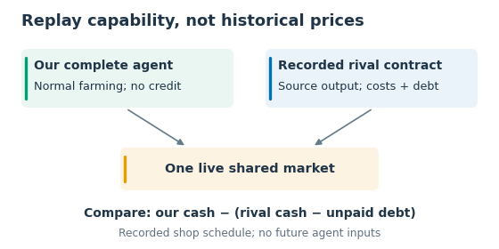

*Figure 10. The candidate runs normally while the environment preserves the opponent's recorded production. Both trade in the live market; any funding advanced to the opponent is deducted from its cash balance.*

The candidate sees only information available at the current turn. Some earlier tests used the same seller on both sides to isolate production strength. The final recorded-production tests used our forecast-guided seller against the baseline rule-based seller.

As a complementary check, **native-agent games** run two complete agents in the official engine under new seeds, without injected production or credit. The contract method preserves demonstrated capability but not a rival's full adaptive behavior. Its results, native results, self-play cash, and actual online results are therefore reported separately.

### 8.2 Final production-layer comparison

The final comparison isolated **adaptive livestock selection**: the crop-only predecessor already had synchronized crop substitutions and the same forecast-guided seller. From 75 recorded online opponents, 12 previously examined scenarios formed the development set. The confirmation set used 18 scenarios selected before simulation, evenly spaced through the remaining 63. The native-agent test used 12 new seed/opponent scenarios across six older local agents.

| Test set | Scenarios | Games per version | Crop-only wins | Crop + livestock wins | Mean margin, old → new | Paired margin gain |
|---|---:|---:|---:|---:|---:|---:|
| Recorded opponents: development | 12 | 24 | 18/24 | 22/24 | 10,323 → 12,682 | +2,359 |
| Recorded opponents: confirmation | 18 | 36 | 30/36 | 32/36 | 10,915 → 12,684 | +1,770 |
| Complete-agent games | 12 | 24 | 24/24 | 24/24 | 8,990 → 9,160 | +171 |

In confirmation, our mean cash rose from 112,406 to 113,130. The opponent's mean cash fell by approximately 1,046, explaining why the margin increase exceeded our own cash increase.

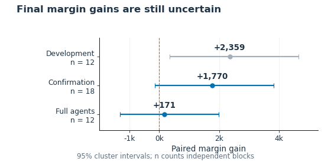

*Figure 11. Mean margin gains with 95% bootstrap intervals, resampling whole scenarios together with their two player positions. The confirmation interval (−144 to +3,828) and complete-agent interval (−1,317 to +1,980) both include zero; the evidence for this final incremental improvement remains uncertain.*

There were 168 formal games in total: 84 candidate and 84 predecessor runs. Daily and whole-season production matched the selected plans; transaction-ledger checks reported no errors. Each paired comparison used the same shop-opening sequence.

Confirmation's worst margin remained −20,372, although its tenth-percentile margin improved from −8,757 to +1,341. In the complete-agent test, some margins became worse even though every game remained a win.

### 8.3 Failed ideas remained part of the evidence

Several negative results shaped the final design:

- **Explicitly penalizing opponent income:** this improved over the baseline seller but underperformed the opponent-aware search that scored our own revenue.
- **Finer search without better supply estimation:** increasing search resolution reduced margin in screening. More detailed enumeration could amplify a poor forecast.
- **Unconditional livestock replacement:** forcing all candidate slots toward sheep caused early funding pressure and production failures in the separate mechanism panel. Forcing cows had opposite economic effects under different shop conditions. Neither became the release policy.
- **More cash but less advantage:** in one confirmation scenario, a livestock change increased our cash by 105 and opponent cash by 6,517. The farm worked, but the economic estimate missed an important interaction.
- **Reliable execution with a weak product mix:** some routes completed production consistently yet still lost to stronger opponents.

The forced-substitution experiments were separate from the 168 games comparing the final candidate with its predecessor.

## 9. What remains open on the farm side

The final agent adapts within a largely preset work schedule. Most movement and long-lived production remain prescribed. Livestock choices concentrate in the middle of the season, and the initial investment structure remains largely fixed.

I see four substantive next steps rather than a larger collection of ad hoc switches:

1. **Expand the library of checked production plans.** Add alternatives only when the entire lifecycle is feasible: labor, maturation, feed, harvest, bags, transport, and the state needed for subsequent work. A reusable plan should expose its costs and delivery curve alongside its end-of-day farm state.
2. **Make the execution interface compositional.** Define entry resources, occupied time and tiles, promised output, and recovery obligations. This could let a planner combine blocks without depending on two historical episodes having exactly the same farm snapshot.
3. **Evaluate product mix by competitive value.** A product's value depends on our supply, the opponent's supply, shop demand, and the seller's response. More milk is not inherently better; neither is diversification for its own sake.
4. **Improve uncertainty and response modeling.** The current market predictor estimates mean volume. Rare large sales and an opponent changing behavior after our trade are not well represented by three scaled mean scenarios. A better model should be accepted through full-game cash and margin, not prediction error alone.

Further work on production and market forecasting should continue together: product mix determines what can be sold, while market conditions determine its value.

### Post-deadline perspectives from other solutions

Two solutions published in October offer useful perspectives on this September 30 submission.

M & M & P & Q describe a hybrid of behavior cloning, self-play PPO, and heuristics. Their published architecture highlights both confidence-ordered repair/final-day search and a separate sequential resource-masking approach. This supports a broader lesson: learned planning and execution constraints need to be designed together. It is a much more ambitious learned-control approach than my final rule-guided agent. [3](https://www.kaggle.com/competitions/kaggriculture/discussion/745073) [4](https://github.com/msdsm/kaggriculture-solution/blob/main/docs/architecture.md)

DECEM publishes an entity-Transformer behavior-cloning approach, with recency-weighted training, recent-day fine-tuning, and team-specific specialization. It uses sequential unit decoding and two small goods-preservation rules. This shows a promising direction for worker-level imitation: consistent demonstrations, suitable state representations, and action-decoding constraints. Its evaluation also branches from recorded games to test alternative behavior. [5](https://www.kaggle.com/competitions/kaggriculture/discussion/745367) [6](https://github.com/Decem-Y/kaggriculture-bc)

## 10. Release verification and reproducibility

### 10.1 Actual online performance

The September 30 release, **submission 56707930**, was queried on October 15, 2026 at 02:36 UTC. The returned completed public games span September 30–October 14 UTC.

| Online metric | Observed result |
|---|---:|
| Reported score snapshot | 2226.6 |
| Completed public games | 925 |
| Wins / losses / ties | 535 / 390 / 0 |
| Win rate | 57.84% |
| Mean terminal cash | 104,604 |
| Mean terminal cash difference | +890 |

The API returned 927 episodes: these 925 games, one self-play validation, and one errored public episode. The latter two are excluded from the completed-game rate. The snapshot covers 470 opponent teams and 592 opponent submissions, with repeated matchups.

Online matchmaking exposes the agent to a different opponent mix and fully adaptive behavior, complementing the controlled local comparisons.

### 10.2 Deployment and reproducibility

The initial Kaggle self-play validation completed with both agents `DONE`, terminal cash **76,801 / 76,801**, and empty sheds and bags. Re-running the uploaded archive on those online observations reproduced all **1,438 actions**. Cold loads were approximately 9.6 seconds; subsequent maximum action times were approximately 0.19 seconds in that validation.

Local experiments used `kaggle-environments 1.32.7`. The experiment archive retains the source files, package and model hashes, verification results, and per-game online statistics.

The [open-source repository](https://github.com/shawny1b0609/kaggriculture-solution) provides the final inference code and assets, a [code map](../ARCHITECTURE.md), [reproduction commands](../REPRODUCING.md), and [compact historical results](../../results/historical). The [full-resolution architecture](figures/detail/architecture_detailed.png) complements the compact diagrams in this report.

## Conclusion

The most useful change in this project was not a bigger network or a bigger decision tree. It was separating reliable execution from competitive value, and then reconnecting them through explicit, testable interfaces.

The final agent keeps a production schedule it can execute, makes a limited number of compatible production choices, and sells with an estimate of the opponent's supply. This produced measurable local gains while preserving tested production. It also left clear weaknesses: narrow farm flexibility, approximate opponent modeling, and limited independent evidence of the last incremental improvement.

My main takeaway is simple: **a farming plan is not good merely because it produces a lot, and a trade is not good merely because it raises our balance. What matters is what both players can earn after the decision—and whether the farm can still execute the plan that follows.**

## References

1. Kaggle. [Official Kaggriculture engine](https://github.com/Kaggle/kaggle-environments/blob/master/kaggle_environments/envs/kaggriculture/kaggriculture.py). Public reference; local experiments used the archived engine identified in the evidence bundle.
2. Kaggle competition discussion. [Daily Top Episodes Dataset](https://www.kaggle.com/competitions/kaggriculture/discussion/731215).
3. M & M & P & Q. [A preview of our solution: BC, Self-Play PPO, and Heuristics](https://www.kaggle.com/competitions/kaggriculture/discussion/745073). October 2, 2026; the rank in the original post title was provisional.
4. M & M & P & Q. [Published architecture and inference design](https://github.com/msdsm/kaggriculture-solution/blob/main/docs/architecture.md).
5. DECEM. [A preview of my solution: Only Behavior Cloning + two small rules](https://www.kaggle.com/competitions/kaggriculture/discussion/745367). October 3, 2026; the rank in the original post title was provisional.
6. DECEM. [Entity-Transformer behavior-cloning repository](https://github.com/Decem-Y/kaggriculture-bc).

*External references reviewed October 15, 2026.*
